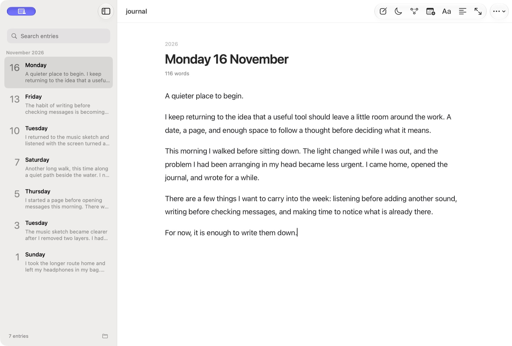
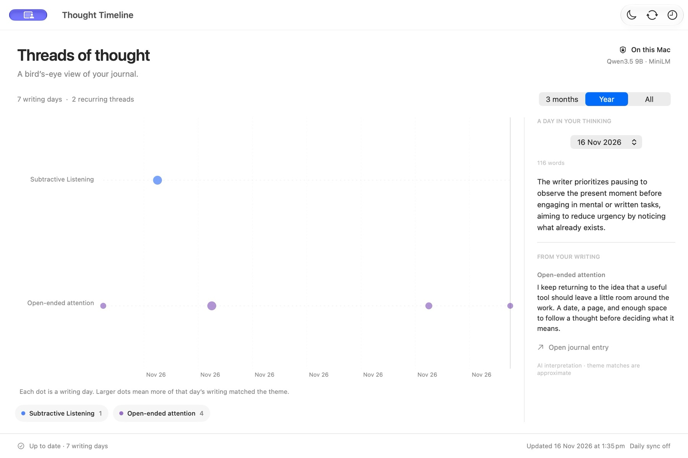

# journal

A quiet place to write, and a way to see which ideas keep returning.

I wanted my journal to feel like a simple Mac app: a list of days, a page, and very little between opening it and writing. This version brings the existing HTML journal into a native SwiftUI window, with focus mode, typewriter scrolling and an optional local AI timeline.



The current native edition is **0.2.8**, for **Apple Silicon Macs running macOS 26 or later**. This repository also retains the earlier React/Tauri desktop app and iOS companion. Their versions and features are separate; `package.json` still identifies the older desktop edition as 1.1.12.

## Writing

- Move between dated entries, search dates and entry previews, or use **New Note** to return to today.
- Switch between day and night, hide navigation with **Focus**, and keep the typing line centred with **Typewriter**.
- Use basic rich-text formatting, lists and quotes. **Add dated note** lets you paste something written elsewhere into the right day, appending to an existing entry when needed.
- Keep the journal in one HTML file. **More → Save Journal To…** chooses the file that subsequent autosaves update. That file can live in a Dropbox folder; Dropbox handles its own upload and sync.
- Keep a private local recovery draft as well as the selected file. If the destination changes outside the app, Journal asks you to review it before replacing it.

Opening a journal imports a local copy and disconnects the previous save destination. Choose **Save Journal To…** afterwards to link the original file or a new destination. **Export a copy…** writes a separate HTML copy.

## Seeing ideas over time

**Recurring themes** opens a separate timeline. A local language model names themes and summarises days, while local embeddings connect related passages across dates. Each lane represents a theme; dots show where it appears. Selecting a dot brings up the day's summary and supporting writing.

The analysis reads the journal and saves its results separately. It does not write into an entry. **Sync now** updates changed writing; an optional user LaunchAgent runs daily at noon, with the time and enabled state controlled in the app. The Mac must be signed in; missed runs after sleep can be coalesced by macOS.

Themes are approximate interpretations, not a complete account of what you were thinking. Dot size represents the share of matched text chunks, not mood or importance. Initial detailed summaries cover the latest seven writing days; older days can be summarised on demand.



*Both screenshots use an isolated demo journal written for this page. No personal entries or analysis data are included in this repository.*

## Build and try it

There is no packaged public installer in this publication. Build the native app from source on an Apple Silicon Mac with macOS 26+, Apple's Command Line Tools with a **macOS 26 SDK**, Node.js 22 and npm. Python 3 is used by the build script. The optional themes runtime has additional requirements below.

```sh
git clone https://github.com/pmancaz/journal.git
cd journal
npm ci
JOURNAL_APP_OUTPUT="$PWD/build/journal.app" bash native/build.sh
```

The script creates and verifies a locally ad-hoc-signed app. Copy `build/journal.app` to Applications using Finder, then open it. A developer-built app is not notarised. The default output, when `JOURNAL_APP_OUTPUT` is omitted, is `../journal.app`.

The scripts select `/Library/Developer/CommandLineTools/SDKs/MacOSX26.sdk` explicitly. If your macOS 26 SDK is elsewhere, set `JOURNAL_MACOS_SDK` to its absolute path; `DEVELOPER_DIR` can select a different Apple toolchain. A newer default SDK is not assumed to be compatible.

On first launch you can explore the sample journal or open your own HTML. Journal recognises dated `h2` headings such as `2026-11-16 Monday` and the older `261116` format. Make a copy before importing an unfamiliar format. Untouched entries retain their HTML; edited rich text is serialised through the editor's supported schema.

### Optional local AI setup

Writing does **not** require a model or account. The current themes setup is an experimental developer workflow that reuses a prepared **Kokoro.app** reading/chat runtime. It is not a self-contained AI installer. It expects:

- `Kokoro.app/Contents/Resources/chat-model/`: [mlx-community/Qwen3.5-9B-MLX-4bit](https://huggingface.co/mlx-community/Qwen3.5-9B-MLX-4bit), including its model index, tokenizer and weights (about 5.6 GB).
- `Kokoro.app/Contents/Resources/chat-packages/`: compatible MLX-LM, MLX, Transformers and Tokenizers packages for Python 3.11. This is the reading/chat model, not Kokoro's speech model.
- Python 3.11 to create a dedicated environment. The setup installs ONNX Runtime 1.23.2 and downloads the small quantised MiniLM embedding model and tokenizer from Hugging Face.

With those resources prepared:

```sh
python3.11 native/setup_timeline.py --kokoro /Applications/Kokoro.app
```

Then open **Recurring themes → Sync now**. Setup downloads require the internet; inference uses local files with offline model settings and no remote AI endpoint. Keep the shared runtime installed. Do not run the setup command on a machine without that prepared runtime and expect it to download Qwen for you. See [the timeline guide](native/TIMELINE.md) for storage, scheduling and model details.

## Development and limits

The native shell uses SwiftUI, Swift Charts and WKWebView; the local editor uses React, TypeScript and TipTap. See [native development notes](native/README.md) and [architecture](project-overview.md). The earlier Tauri interface can still be developed with `npm run tauri:dev` after installing the [Tauri prerequisites](https://v2.tauri.app/start/prerequisites/). The iOS companion in `ios/JournalMobile` is retained separately and was not validated for this native release.

```sh
python3 -m venv .venv
.venv/bin/python -m pip install numpy
JOURNAL_TEST_PYTHON="$PWD/.venv/bin/python" bash native/check.sh
```

Checks use synthetic data and temporary storage, without loading the AI model or changing the installed app. UI and inference checks are separate. Fullscreen appearance, empty-entry carets, selection, saving and recovery received fixes in 0.2.8; this remains a personal software project. The native interface does not expose every legacy Tauri feature, including its diagram-creation controls or Markdown export. It exports HTML.

Local recovery, settings and private derived analysis live under `~/Library/Application Support/com.pcjournal.native-preview`. The identity remains unchanged for compatibility with earlier native builds. Those files, journal documents, models, environments and app bundles are excluded from this source backup. Choosing a Dropbox folder does not make Journal verify cloud-sync completion.

## Acknowledgements and licence

Journal's existing [MIT licence](LICENSE) covers the application code. Third-party packages, fonts and models retain their own licences; see [third-party acknowledgements](docs/ACKNOWLEDGEMENTS.md). Qwen3.5-9B and its MLX conversion, and all-MiniLM-L6-v2, use Apache-2.0. Model weights and runtime packages are downloaded separately and are not redistributed here.

[Product page](https://pcarroll.au/tools/journal/) · [Changelog](CHANGELOG.md)
